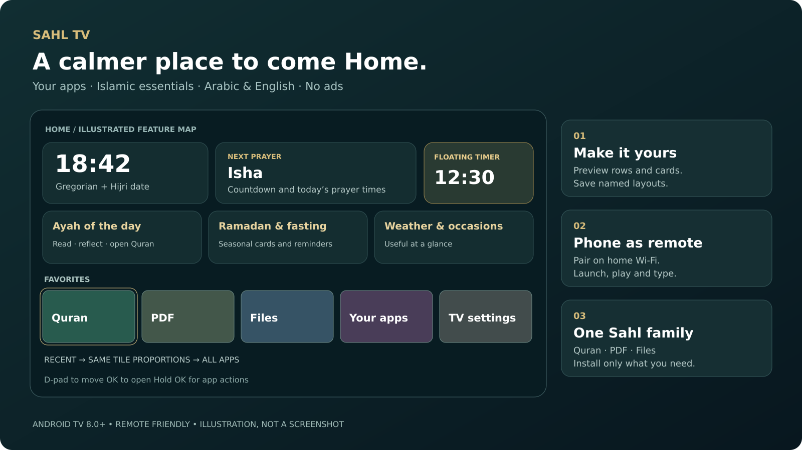
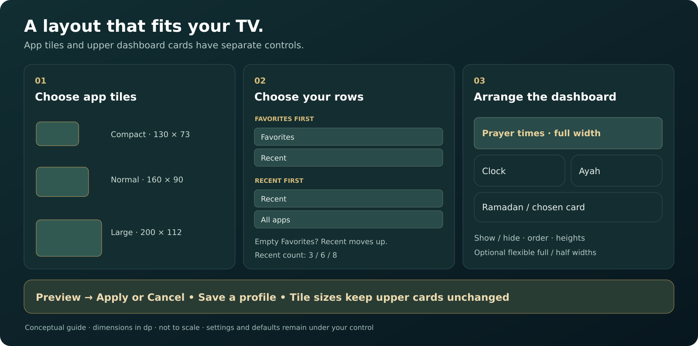

<div align="center">

# Sahl TV · سهل
### Your TV. Your apps. Your home.

A calm, ad-free Android TV launcher with Arabic & English, Islamic essentials, a phone remote, and a layout you control.

[**Download SahlTV.apk**](https://github.com/AliSherif1309/SahlTV-Launcher/releases/download/latest/SahlTV.apk) · [All releases](https://github.com/AliSherif1309/SahlTV-Launcher/releases) · [Installation](#install-in-a-few-minutes) · [Report a problem](https://github.com/AliSherif1309/SahlTV-Launcher/issues)

[](https://github.com/AliSherif1309/SahlTV-Launcher/actions/workflows/build.yml)
[](https://github.com/AliSherif1309/SahlTV-Launcher/actions/workflows/readme-review.yml)
[](LICENSE)



*Illustrated feature map, not an app screenshot. App names and times are examples; appearance depends on your settings and TV.*

</div>

## Why put Sahl on your TV?

- **Get straight to your apps.** Favorites, Recent and All Apps, with D-pad navigation and no advertising feed.
- **Make the layout yours.** Preview changes, choose row order, match tile sizes, arrange dashboard cards, and save named profiles.
- **Keep Islamic essentials close.** Prayer times and countdown, Hijri date, daily Ayah, adhkar, Ramadan and Sunnah fasting cards.
- **Use Arabic comfortably.** Right-to-left UI, packaged Thmanyah typography, 123 / ١٢٣ numerals, larger text and warmer night styling.
- **Control it from your phone.** Pair a browser on your home Wi-Fi to launch apps, control playback and type on the TV.
- **Keep a timer in view.** A remote-friendly countdown on Home, with an optional overlay above other apps.

**For Android TV / Mi TV running Android 8.0+ (API 26).** Firmware behavior varies; release validation uses Android TV emulators, and does not imply physical testing on every TV. Prayer calculations and selectable cities currently focus on **Qatar**.

## New and improved

| Feature | What you can do |
| --- | --- |
| **Home Layout 2.2** | Choose 3, 6 or 8 Recent apps and tight, normal or spacious tile spacing. |
| **Flexible dashboard** | Show/hide, reorder and resize upper cards; optionally arrange supported cards at full or half width. Prayer times stay full width. |
| **Visual layout editor** | See actual Favorites/Recent app names, choose the first row, and Apply or Cancel staged changes. Empty Favorites lets Recent appear first. |
| **Consistent app tiles** | Compact, Normal or Large proportions across every app row. Changing tiles keeps upper dashboard card sizes. |
| **Layout profiles** | Default, Minimal and Family presets, plus three named custom slots. |
| **Floating timer** | Set 1–180 minutes; start, pause, resume, reset, show/hide and choose a corner. Optional above-app mode requires overlay permission. |
| **Arabic prayer banners** | Prayer overlays now use Thmanyah and the saved numeral style. |

## A home screen you can arrange



*Conceptual layout guide. Dimensions are the app's tile presets in dp; the diagram is not to scale.*

Open **Settings → Home layout**. Choose app tile size, row visibility/order, combined or separate rows, Recent count and spacing. Adjust upper dashboard cards separately, preview your arrangement, then **Apply**. Save a profile to return to it later.

Hold **OK** or press **Menu** on an app to manage favorites, move it, hide it, open app info or uninstall it. A four-digit PIN can protect apps and optionally the TV settings button.

## Install in a few minutes

1. [Download SahlTV.apk](https://github.com/AliSherif1309/SahlTV-Launcher/releases/download/latest/SahlTV.apk) to your PC.
2. Enable developer options and USB/network debugging on the TV; find its IP address in network settings. Install [Android Platform Tools](https://developer.android.com/tools/releases/platform-tools) on your PC.
3. Connect and install, replacing the example IP with your TV's address:

   ```sh
   adb connect 192.168.1.50:5555
   adb install -r SahlTV.apk
   ```

4. Open **Sahl TV** from your TV's app list and try it with the remote.

Some TVs use wireless-debugging pairing and a different port; follow the address/pairing instructions shown by your TV.

<details>
<summary><b>Make Sahl the default Home screen · reversible ADB setup</b></summary>

Use your TV's default-home selector if it offers one. Otherwise, first confirm Sahl opens successfully, then list the Home apps:

```sh
adb shell cmd package query-activities --brief -a android.intent.action.MAIN -c android.intent.category.HOME
```

Identify the stock launcher package (not `com.aly.sahltv`), substitute its actual name below, and keep that name for recovery:

```sh
adb shell pm disable-user --user 0 STOCK_LAUNCHER_PACKAGE
```

Press **Home**. To restore the original launcher:

```sh
adb shell pm enable --user 0 STOCK_LAUNCHER_PACKAGE
```

Do not disable unrelated system packages. Keep ADB available until Home works.

</details>

## More than an app grid

| Everyday feature | How it helps |
| --- | --- |
| Prayer dashboard | Next prayer countdown, today's times and Sunrise; Qatar city selection, adjustments and optional silent prayer banners. |
| Islamic cards | Hijri date adjustment, Ayah of the day, adhkar, Ramadan/Iftar/Suhoor and upcoming Sunnah fasts. |
| Look & comfort | Islamic or Classic styling, mosque wallpapers, photo brightness, calm mode, text size and night style. |
| Phone remote | One-time pairing window, per-phone keys, playback controls and optional keyboard input. |
| Now playing | Playback and Open controls when media-session access is configured. |
| Optional app previews | Enable selected recommendation rows from apps that publish them; disabled by default. |
| Clock screensaver | A dim moving clock after idle time; wakes with a key and stays off during playback. |
| Backup & restore | Export preferences to `Download/SahlTV-backup.json` and keep a copy off the TV. |
| Diagnostics | See startup, app readiness, frame timing and memory measurements on your own TV. |
| Checked updates | Update from the TV; APK hash, package and signing checks protect installation. |

**Memory cleaning is optional.** Auto clean is off by default: keeping recently used apps in memory can make reopening them faster. The cleaner protects recent apps, current playback and Sahl apps.

### Pair your phone

On the TV, open **Settings → Phone remote → Pair a phone**. On a phone connected to the same home Wi-Fi, open the address shown on the TV and enter its one-time six-digit code. Pairing lasts three minutes; five incorrect attempts close it. Manage or revoke devices under **Paired phones**.

The remote uses local HTTP and relies on trusted home Wi-Fi. Some actions need one-time ADB setup; see the [permissions guide](docs/REFERENCE.md#optional-permissions).

### Start a floating timer

Open **Settings → Look & comfort → Floating timer**. Set a duration, start it, and choose a screen corner. Home-only mode works without overlay permission. For **Above other apps**, follow the permission help, return Home, and explicitly enable the option.

The timer is a visual countdown, with no alarm sound or automatic TV shutdown. Some firmware and protected video can suppress overlays. See [timer behavior and limitations](docs/REFERENCE.md#floating-timer-android-tv).

## One Sahl family · four TV apps

Install only the apps you want. **Sahl apps** lists installed versions and opens companion apps; Sahl TV handles checked installs and updates.

<!-- BEGIN AUTO:APP_VERSIONS -->
| App | Source version | Minimum Android API | Download |
| --- | --- | --- | --- |
| Sahl TV | 1.23 | 26 | [SahlTV.apk](https://github.com/AliSherif1309/SahlTV-Launcher/releases/download/latest/SahlTV.apk) |
| Sahl Quran | 1.10 | 26 | [SahlQuran.apk](https://github.com/AliSherif1309/SahlTV-Launcher/releases/download/latest/SahlQuran.apk) |
| Sahl PDF | 2.5 | 26 | [SahlPDF.apk](https://github.com/AliSherif1309/SahlTV-Launcher/releases/download/latest/SahlPDF.apk) |
| Sahl Files | 1.5 | 26 | [SahlFiles.apk](https://github.com/AliSherif1309/SahlTV-Launcher/releases/download/latest/SahlFiles.apk) |
<!-- END AUTO:APP_VERSIONS -->

Versions above describe the source in this branch; download links point to the latest **published, validated** release and may lag an unmerged change.

- **Sahl Quran:** Mushaf and large-text views, Surah/Juz/page navigation, bookmarks, reading timer, daily goals, family readers and your own Mushaf PDF.
- **Sahl PDF:** Book covers, Continue reading, one/two-page view, RTL books, zoom, paper themes, bookmarks and PDF upload from your phone.
- **Sahl Files:** Internal/USB storage, copy/move/rename/delete, picture/text viewing and receiving files from your phone.

## Updates and reliability

On the TV, choose **Updates → Check for updates**. Auto-update preferences offer Off, Tell me, or Download & install; Android may still require you to confirm installation.

Every main-branch release builds all four apps, runs source checks, and validates candidate APKs on **1 GB and 2 GB Android TV emulators** before publication. Numbered releases contain APKs, SHA-256 fingerprints and performance reports. [View releases](https://github.com/AliSherif1309/SahlTV-Launcher/releases) · [Validation details and recovery](docs/REFERENCE.md#-updates-you-can-trust-and-recover-v120).

## Build and contribute

The project uses Kotlin, Android framework APIs, **JDK 17**, **Gradle 8.7** and Android SDK 34. Modules: `app`, `quran`, `pdf`, `files`, and shared `common`.

See the [build workflow](.github/workflows/pr-compile.yml) for the complete generated-asset preparation and build sequence. A local build without signing secrets uses a debug key; without `FONT_KEY`, apps fall back to the system font. Thmanyah files are not redistributed as raw fonts.

Found a problem? [Open an issue](https://github.com/AliSherif1309/SahlTV-Launcher/issues) with your TV model, Android version, app version and steps to reproduce. Screenshots and **Settings → Diagnostics** results help. Feature ideas and pull requests are welcome.

### Keeping this page current

[README review](.github/workflows/readme-review.yml) runs on every pull request and push to `main`, plus manual runs. It checks generated app versions, local documentation links/images, and whether changed implementation files have a documentation update or an explicit explanation. It writes a changed-file review summary and uploads a suggested patch when generated versions are stale.

For any feature or behavior change, update the relevant README section and [detailed reference](docs/REFERENCE.md), refresh illustrations when needed, and run:

```sh
python3 tools/readme_review.py --write
python3 tools/readme_review.py --check
python3 -m unittest discover -s tools -p 'test_readme_review.py'
```

For internal changes with no reader impact, put `README review: not needed — <specific reason>` in the PR description (or commit message for direct pushes). This records a human decision; the workflow does not claim to understand every feature or automatically invent feature descriptions. See [documentation maintenance](docs/DOCUMENTATION.md).

## Credits and license

Code: [MIT](LICENSE). Quran text: [Tanzil](https://tanzil.net), unchanged Uthmani text, CC BY 3.0. Quran typography: Amiri Quran, SIL OFL. Thmanyah typography follows its separate font license; local builds use system fonts without the font secret. Wallpaper attribution is checked at build time and shown in About; see the [detailed credits and feature reference](docs/REFERENCE.md).

Contact: alysherif1309@gmail.com
